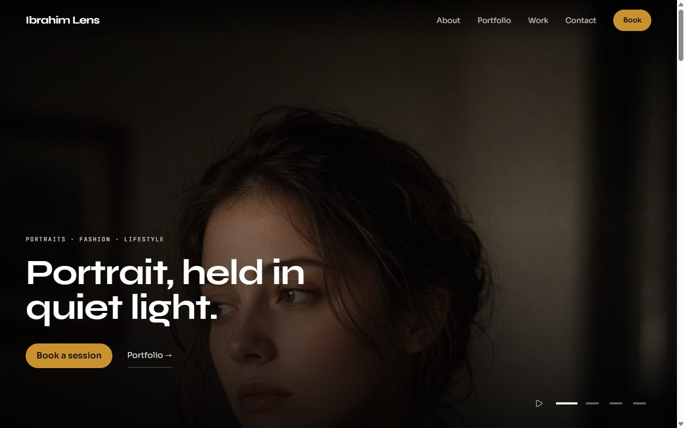
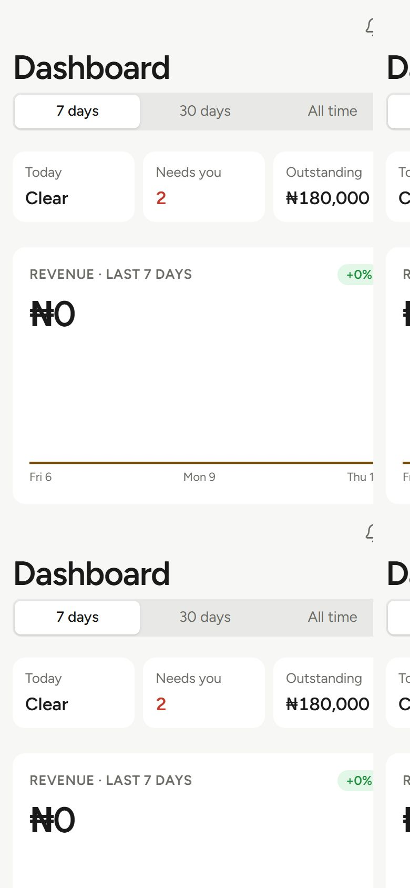

# Ibrahim Lens

I built a desk for a photographer who was keeping inquiries, dates, payments, and photos in different places, and who could not change his own website. The desk is where he sees who wrote, who is booked, the fee, what has been paid, whose pictures those are, and what the public site says. He uses it on his phone.

The public pages are what clients see. Studio is where he works. The assistant can talk, and it can only hand over a job. A separate part does the writing, through the same path as the buttons, and each step shows up on a card. The model does not write, and the photo files never go to the model.

The live site is [ibrahimlens.com.ng](https://ibrahimlens.com.ng). The longer write-up, with the screens, is the [case study](https://princegodsplan.github.io/ibrahim-lens-case-study/).

React, Vite, TypeScript, Tailwind, PocketBase, Docker, Caddy. The application is not in this repo. The screens use made-up clients and generated photographs.

